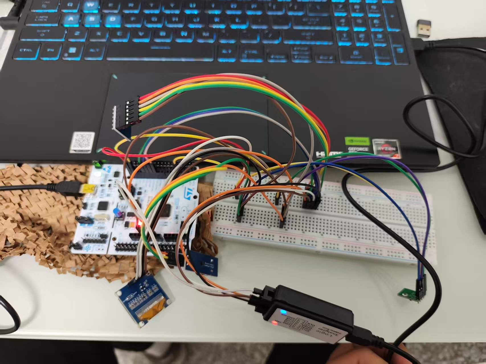

# 陈荣旭 · MCU / 嵌入式软件实习

**四川农业大学（211） · 物联网工程本科 · 2028 届**

地点不限 · 可随时到岗 · 可全职实习 6 个月

[邮箱联系](mailto:Rongxu1126@foxmail.com) · [STM32 + FreeRTOS 项目](https://github.com/chenrongxu1010-web/stm32-environment-monitor) · [小禾校园搭子](https://github.com/chenrongxu1010-web/campus-assistant-prototype)

我围绕 **C、STM32 和 FreeRTOS** 做嵌入式开发实践：从外设驱动与裸机主循环，逐步完成五任务环境监测工程，使用消息队列分发数据、Mutex 保护共享总线、信号量连接中断与任务，并结合 UART 和逻辑分析仪排查板级问题。

## STM32 + FreeRTOS 多任务环境监测与报警终端

个人项目 · NUCLEO-F401RE / ARM Cortex-M4

`C` · `STM32 HAL` · `CMSIS-RTOS2` · `I2C` · `SPI` · `UART` · `EXTI`

*实际联调接线。项目仓库提供完整引脚表、源码、架构图和 SPI 波形记录。*

### 实现与设计

| 关注点 | 我的实践 |
| --- | --- |
| 五任务与数据分发 | 采集、显示、报警、串口、按键分别由独立任务处理；通过三路独立消息队列分发温湿度数据，每路容量为 5，避免多个消费者争用同一条消息。 |
| 资源保护与事件通知 | AHT20 与 OLED 共用 I2C，由 Mutex 保护；EXTI 回调消抖后释放二值信号量，ButtonTask 接收事件并切换报警使能。 |
| 滞回报警与配置 | 任一测量值达到触发阈值即报警，两项都满足恢复条件才解除。封装 W25Q64 擦写及配置校验接口；当前默认使用 RAM 阈值，Flash 路径保持隔离。 |
| 板级调试 | 使用 PulseView 采集与解码 SPI，结合 UART、JEDEC ID、状态寄存器和 HAL 返回值排查；保留历史接线问题与后续偶发异常的诊断记录。 |
| 运行观测 | 监测五个任务的栈高水位及三路队列投递失败计数，保留消费者降速的队列压力测试程序和 Flash 只读捕获程序。 |

**验证进展（2026-11-22）：** 正常、队列压力和 Flash 只读捕获三种模式均完成干净构建，0 errors / 0 warnings。构建结果、历史实机证据及待执行测试分别归档；Flash 擦写与掉电可靠性、CPU/Heap 专项验证和长时间稳定性仍需补齐实机记录。

[查看源码与使用说明 →](https://github.com/chenrongxu1010-web/stm32-environment-monitor) · [FreeRTOS 设计](https://github.com/chenrongxu1010-web/stm32-environment-monitor/blob/main/docs/freertos-design.md) · [测试记录](https://github.com/chenrongxu1010-web/stm32-environment-monitor/blob/main/docs/testing-record.md) · [Flash 调试档案](https://github.com/chenrongxu1010-web/stm32-environment-monitor/blob/main/docs/flash-diagnostics.md)

## 技术基础

| 方向 | 实践内容 |
| --- | --- |
| C 语言 | 使用指针、数组、结构体和位运算处理外设数据；组织多文件 C 工程，封装模块接口。 |
| STM32 | 基于 STM32F401RE 和 HAL 配置 GPIO、UART、I2C、SPI、TIM 与 EXTI；使用 CubeMX、CubeIDE 和 ST-LINK 烧录、单步调试。 |
| FreeRTOS | 使用 CMSIS-RTOS2 创建任务、配置优先级，应用 Queue / Mutex / Semaphore，监测任务栈与队列投递结果。 |
| 板级调试 | USB 逻辑分析仪、PulseView、UART 日志、状态寄存器、HAL 返回值与万用表。 |
| 开发工具 | WSL / Ubuntu、GCC 多文件编译、GDB 断点调试、Git 版本管理。 |

## 小禾校园搭子 · 个人开发（AI 辅助）

已发布的校园服务微信小程序，覆盖课表管理、校园信息与美食查询等场景。**2026-11-01 后台快照：累计用户 326。**

`微信原生小程序` · `FastAPI` · `MySQL` · `Docker` · `微信云托管`

- **开发与交付：** 负责需求拆解、功能取舍、真机验收与版本发布；借助 Codex 分模块实现小程序和服务端，参与云托管部署与提审。
- **异常修复：** 针对课表保存成功但返回失败后重复新增的问题，协同拆分保存与跳转状态，使重试只触发跳转，存储失败时保留输入。
- **验证：** 通过模拟器与回归测试核对新增、编辑及错误恢复行为，项目展示页提供界面预览、工程案例和验证范围。

[查看产品与工程案例 →](https://github.com/chenrongxu1010-web/campus-assistant-prototype) · 微信搜索“小禾校园搭子”体验已发布版本。

## 更多实践

[自动化测试与日志分析工具](https://github.com/chenrongxu1010-web/auto-test-log-analyzer)：使用 Python / Shell 批量执行模拟任务、分析日志并生成报告，练习回归验证流程。

校足球队成员，参加“川超”等省级赛事。

---

欢迎交流 MCU / 嵌入式软件实习机会：**[Rongxu1126@foxmail.com](mailto:Rongxu1126@foxmail.com)**
