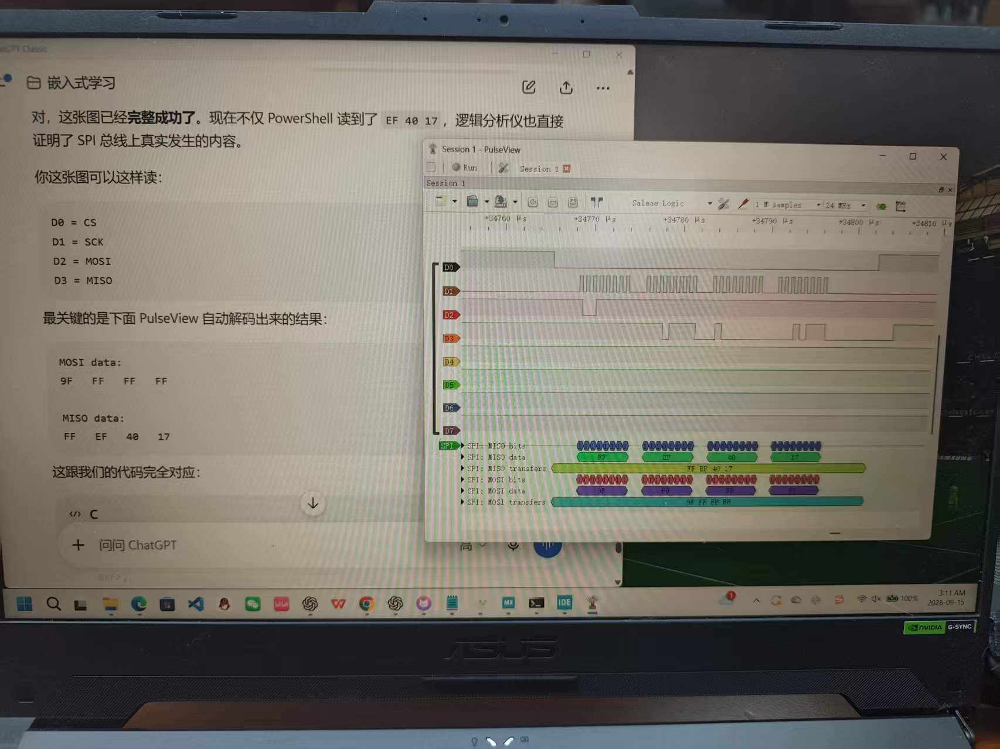

# 陈荣旭 | 嵌入式软件实习生

四川农业大学 · 物联网工程本科 · 2028 届

**求职状态：地点不限 · 可随时到岗 · 可全职实习 6 个月**
联系邮箱：[Rongxu1126@foxmail.com](mailto:Rongxu1126@foxmail.com)

围绕 **C / STM32 外设开发、模块化设计与软硬件联调**积累实践。环境监测终端已从裸机演进为 FreeRTOS 五任务工程，使用独立消息队列、I2C Mutex 和按键信号量组织业务，持续完善可靠性验证。

## 主打项目：STM32 环境监测与报警终端

**[查看项目与构建说明 →](https://github.com/chenrongxu1010-web/stm32-environment-monitor)**

`C` · `STM32F401RE` · `HAL` · `FreeRTOS / CMSIS-RTOS2` · `STM32CubeIDE` · `I2C` · `SPI` · `UART` · `EXTI`

基于 NUCLEO-F401RE，串联温湿度采集、数据显示、报警判断及参数存储，重点实践外设通信和故障定位。

| 实践内容 | 实现与证据入口 |
| --- | --- |
| 采集与显示 | 通过 I2C 驱动 AHT20 与 SSD1306，实现温湿度采集、OLED 显示及 UART 调试输出。[主程序](https://github.com/chenrongxu1010-web/stm32-environment-monitor/blob/main/Core/Src/main.c) |
| Flash 参数存储 | W25Q64 驱动包含 JEDEC ID 读取、扇区擦除、页编程及数据读取；配置模块支持阈值保存、上电加载与合法性检查。[Flash 驱动](https://github.com/chenrongxu1010-web/stm32-environment-monitor/blob/main/Core/Src/w25q64.c) · [配置模块](https://github.com/chenrongxu1010-web/stm32-environment-monitor/blob/main/Core/Src/config.c) |
| 模块划分与按键处理 | 分离传感器、显示、Flash、配置及报警模块；EXTI 通过二值信号量通知 ButtonTask，切换蜂鸣器使能。 |
| 软硬件联调 | 结合 UART 日志、HAL 返回值、状态寄存器及 PulseView SPI 解码逐层排查；保留 SPI 波形与历史接线排查记录，后续偶发 Flash 异常的最终根因仍待验证。 |

**当前进展：** 五任务工程、三路容量为 5 的队列及 OR 触发 / AND 恢复逻辑已纳入仓库；正常、队列压力和 Flash 只读捕获模式均构建通过。Flash 默认隔离，压力测试、掉电持久化和长期稳定性仍待真机验证。

### 实物与调试记录

*开发过程中的原型接线记录，展示实际搭建环境；完整引脚表见项目仓库。*

查看 SPI 总线采集与 JEDEC ID 解码照片

照片中的 PulseView 解码显示 MOSI 为 `9F FF FF FF`，MISO 为 `FF EF 40 17`；命令字节对应的接收值之后，ID 字节为 `EF 40 17`。这是一次实际总线采集记录，说明该次读取事务得到上述响应；完整功能与长期稳定性仍需独立验证。

## 技术基础与当前学习

| 方向 | 当前积累 |
| --- | --- |
| C 语言 | 指针、数组、结构体、位运算；多文件工程、头文件管理及模块接口封装。 |
| STM32 | 基于 STM32F401RE 与 HAL 进行外设开发，使用 CubeMX / CubeIDE、ST-LINK 烧录与调试。 |
| 调试与工具 | UART 日志、USB 逻辑分析仪与 PulseView；WSL / Ubuntu 下使用 GCC、GDB；Git，Python / Shell 基础。 |
| FreeRTOS | 五任务、消息队列、Mutex、Semaphore、栈高水位与投递失败计数已用于项目；Event Flags 仍未用于主项目业务同步。 |

下一步验证报警边界与并发访问、队列压力恢复、栈/堆余量和 Flash 可靠性，补齐持续运行的实机记录。

## 补充项目：软件工程实践

### [小禾校园搭子 | 校园服务微信小程序](https://github.com/chenrongxu1010-web/campus-assistant-prototype)

`JavaScript` · `Python / FastAPI` · `MySQL` · `微信云托管`

- 已有版本发布；2026-11-01 后台截图显示累计用户 **326**，当日访问人数 **23**。项目资料覆盖课表管理、校园信息、美食查询与课程复习，近期本地改动与线上版本的差异见项目说明。
- 负责功能范围、优先级与资料输入，借助 AI 协作编写代码与回归测试，通过手机体验和模拟器核对功能。
- 协同修复课表保存成功但返回失败引发重复新增的问题，将保存状态与跳转重试分离，保留存储失败时的表单。

[查看产品介绍、界面预览与工程案例 →](https://github.com/chenrongxu1010-web/campus-assistant-prototype) · 微信搜索“小禾校园搭子”体验已发布版本。公开仓库为项目展示资料。

### [自动化测试与日志分析工具](https://github.com/chenrongxu1010-web/auto-test-log-analyzer)

`Python` · `Shell` · `Linux / WSL` · `unittest`

批量执行模拟任务，分析日志并输出 CSV / Markdown 报告，练习测试用例、缺陷记录和回归验证流程。当前使用模拟任务。

---

欢迎通过邮箱联系，交流嵌入式软件实习机会、项目实现与调试过程。
